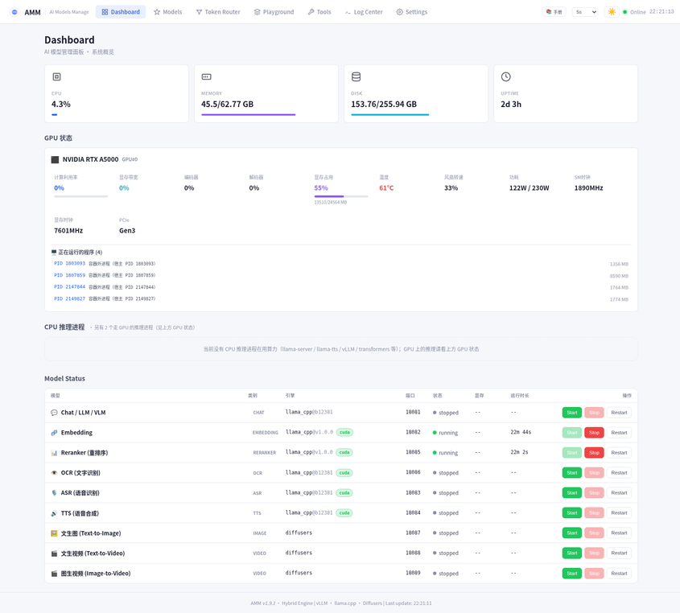
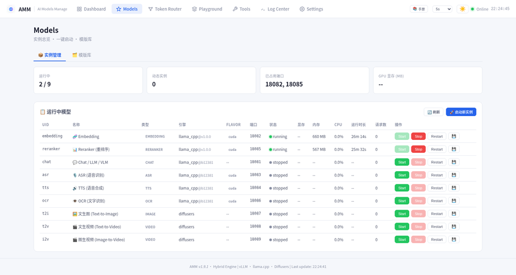
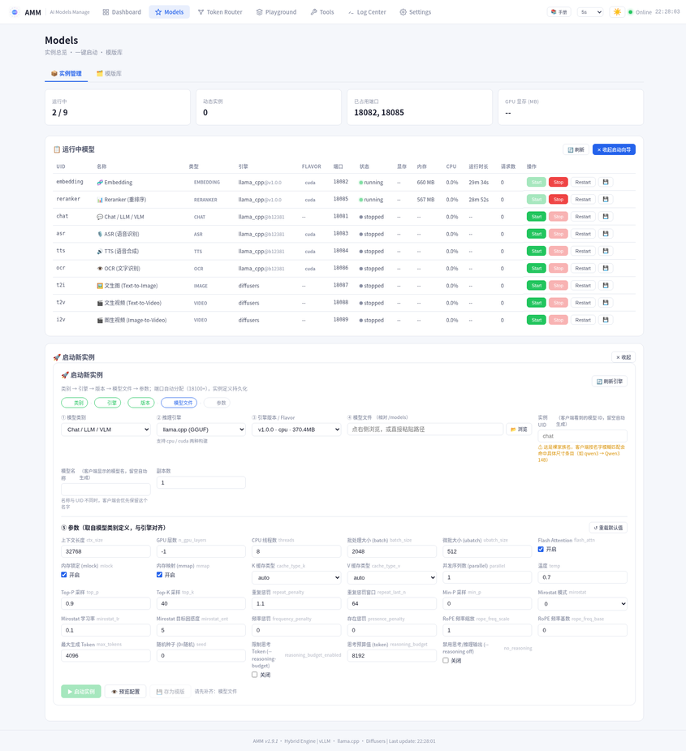
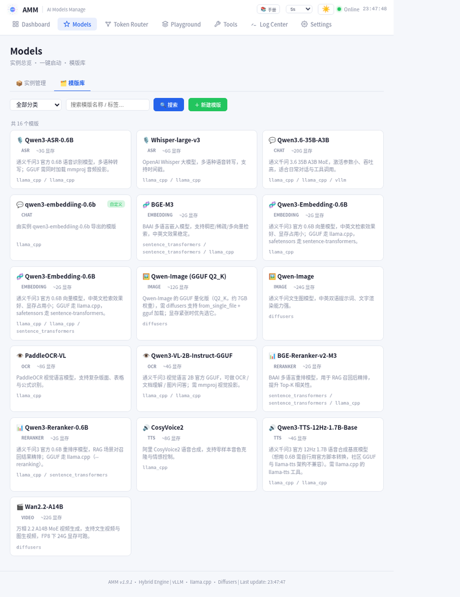
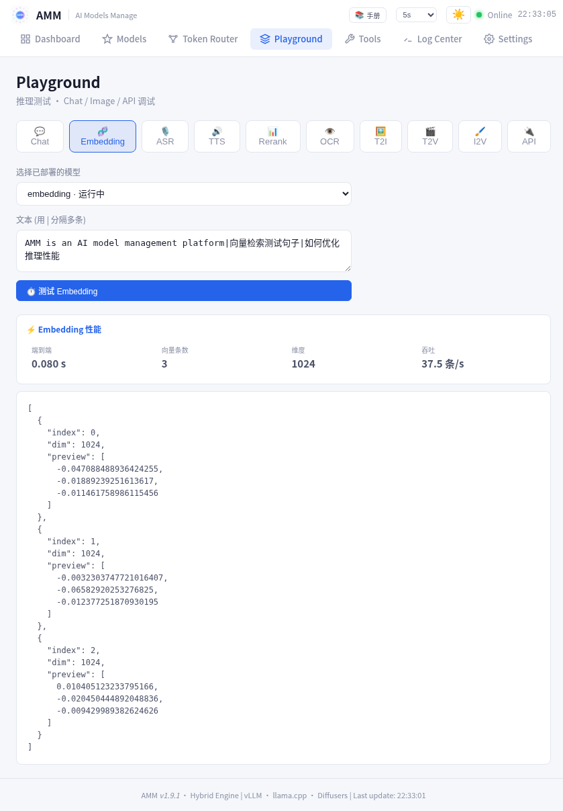
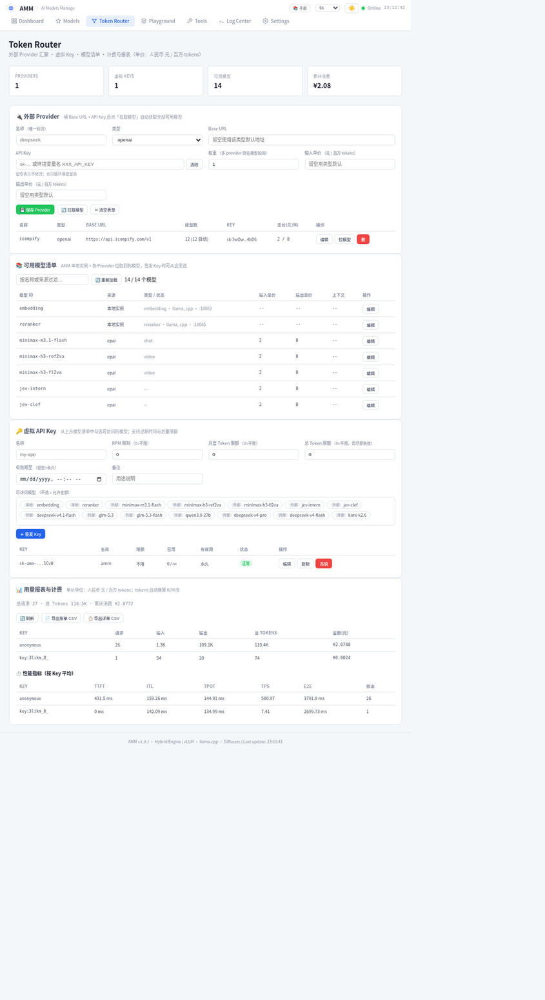
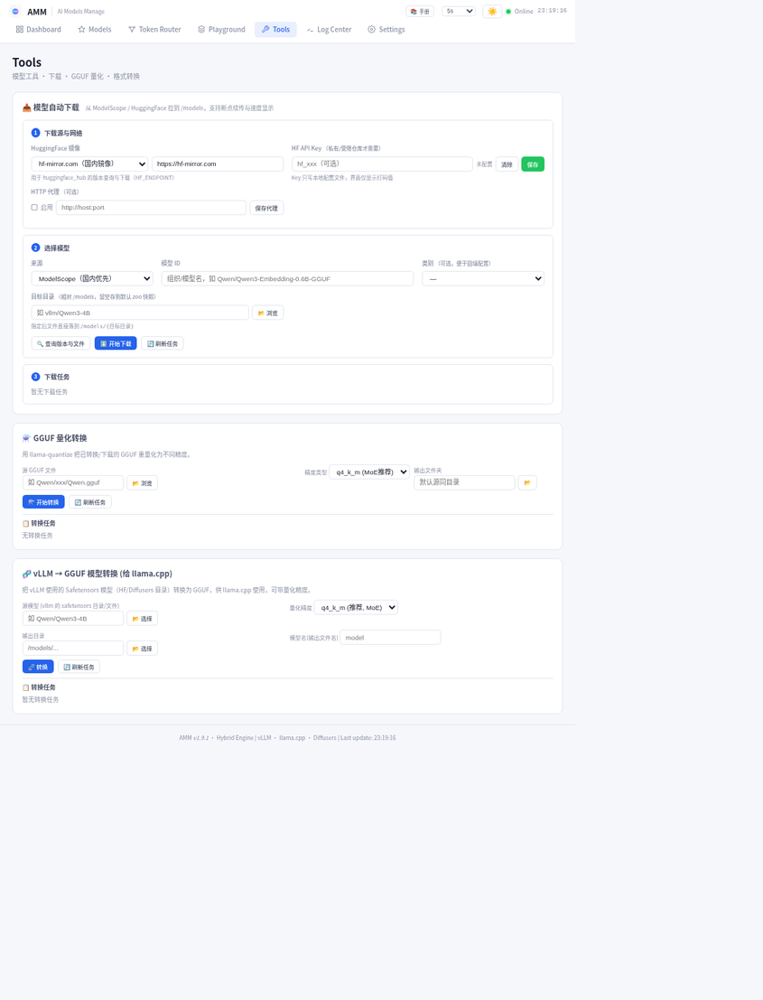
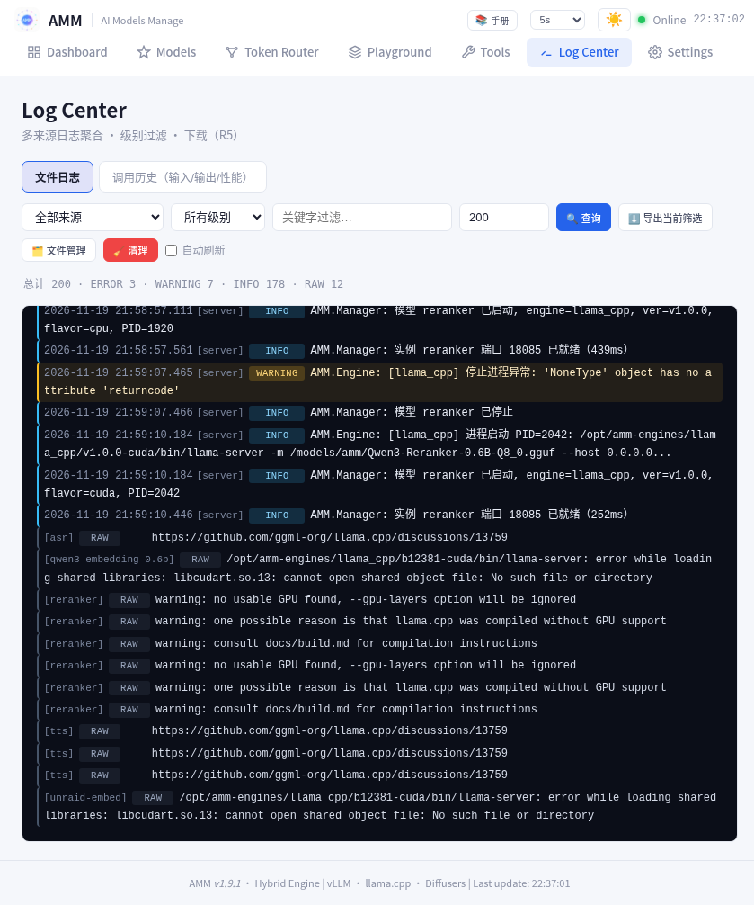

# AMM — AI Models Manage

**Nine categories of local AI models × four inference engines, behind one web UI.**

[](https://github.com/ggerganov/llama.cpp)
[](https://python.org)
[](LICENSE)
[](CHANGELOG.md)
[](#getting-started)

[简体中文](./README.md) ｜ **English**

---

## What it is

AMM is a self-hosted management platform for local AI models. It brings **nine model categories** —
Chat/LLM/VLM, Embedding, Reranker, ASR, TTS, OCR, Text-to-Image, Text-to-Video, Image-to-Video —
and **four inference engines** — llama.cpp, vLLM, Diffusers, sentence-transformers — into **one web UI**:

> Pick a model → click start → test it in the browser → paste the OpenAI-compatible `base_url` into any client.

No memorizing dozens of launch flags. No separate script per model type. No building your own API gateway.

```
Browser ──► AMM WebUI (:80)
              │
              ├── /api/*   management (instances / engines / files / logs / metrics)
              └── /v1/*    OpenAI-compatible API (chat / embedding / asr / tts / ocr / rerank / images / videos)
                     │
        ┌────────────┼─────────────┬──────────────────┐
     llama.cpp       vLLM       Diffusers      sentence-transformers
     (GGUF/CPU+GPU) (throughput) (image/video)     (embedding)
```

### Who it's for

| If you are | AMM gives you |
|---|---|
| **A local-AI hobbyist** | No Python / CUDA / compile wrangling — install and run |
| **Self-hosting / homelab user** | Many models on one GPU box, one entry point, one dashboard |
| **A developer** | llama.cpp and vLLM side by side; params, versions, logs in one place |
| **A small team / internal provider** | Token Router for MaaS: virtual keys, rate limits, quotas, billing |
| **A RAG / agent builder** | embedding + reranker + chat fully local, one base_url |

### What it replaces

| The traditional way | With AMM |
|---|---|
| Read docs, assemble dozens of flags | Pick engine and model file; parameters are pre-filled |
| One launch script per model type | Unified instance model for all nine categories |
| Build your own gateway for auth and billing | Built-in OpenAI-compatible API + Token Router |
| Reinstall the environment to switch engines | Install/uninstall engines from the UI, CPU and CUDA builds |
| Scroll terminal output to debug | Log center with source/level filters and one-click download |

---

## Screenshots

















> More in [docs/screenshots/](./docs/screenshots/).

---

## Capabilities

### Nine categories, one instance model

| Category | Use case | Engines |
|---|---|---|
| Chat / LLM / VLM | Conversation, generation, vision | llama.cpp, vLLM |
| Embedding | Vectors, semantic search, RAG | llama.cpp, sentence-transformers |
| Reranker | Re-ranking retrieval results | llama.cpp |
| ASR | Speech to text | llama.cpp |
| TTS | Text to speech | llama.cpp |
| OCR | Text from images | llama.cpp |
| T2I | Text to image | Diffusers |
| T2V | Text to video | Diffusers |
| I2V | Image to video | Diffusers |

### Four engines, installed from the UI

| Engine | Supports | Builds |
|---|---|---|
| llama.cpp | chat / embedding / reranker / asr / tts / ocr | cpu, cuda |
| vLLM | chat / embedding (high throughput) | cuda |
| Diffusers | image / video generation | cuda |
| sentence-transformers | embedding | cpu, cuda |

Versions can be queried, downloaded, installed and removed in the browser.
Multiple instances of the same category can run concurrently (different model or precision),
each with its own UID and port.

### OpenAI-compatible: any client works

```
/v1/chat/completions      /v1/embeddings
/v1/audio/transcriptions  /v1/audio/speech
/v1/ocr                   /v1/rerank
/v1/images/generations    /v1/videos/generations
/v1/models                /v1/models/{id}
```

Cherry Studio, Open WebUI, Chatbox, OpenClaw, Claude Code or any OpenAI SDK — change `base_url` and go.

### Token Router: a gateway for serving others

- Add external providers (OpenAI / Anthropic / DeepSeek / icompify / custom) with Base URL + Key and pull the model list
- Issue virtual API keys with RPM limits, monthly/total quotas, expiry and model allowlists
- Usage and cost reports per key or per model, exportable to CSV
- Call history stores each request's input, real output and metrics (TTFT / TPS)

### Operations without memorizing commands

| Capability | Description |
|---|---|
| Live metrics | CPU / memory / disk / GPU (utilization, VRAM, temperature, power, processes) |
| CPU process monitor | CPU inference processes listed separately: PID / binary / CPU / memory / threads / uptime |
| Log center | Filter by source, level or keyword; export, clear, auto-rotate; polling noise filtered out |
| File manager | Browse, edit, upload, download inside allowed roots; deletes go to a trash folder |
| Template library | Ready-made templates across ASR / TTS / Embedding / Reranker / VLM / OCR / image / video; save your own |
| Launch command composer | Generate the full command from current params → edit → save as the start script |
| Settings search | Full-text search, section index chips, expand-all |
| Branding | Project name, subtitle, logo, title bar and favicon |
| Light theme | One-click ☀️ / 🌙 toggle, persisted in localStorage |

---

## Getting started

Goal: **installed in 5 minutes, first inference request working.**

### 0. Requirements

- Linux (Rocky 9 / Ubuntu 22.04 / Debian 12, or Unraid 7.x)
- Python 3.11+ (already in the image)
- NVIDIA GPU optional — CPU runs embeddings and small LLMs; ≥24GB VRAM recommended for 7B+ or video
- CUDA 13.2+ when using a GPU; the image ships the full toolchain (incl. nvcc), and `install.sh` fills gaps

### 1. Start the container

```bash
mkdir -p /path/to/amm/{app,data,logs,engines} /path/to/models

docker run -d --name AMM \
  --restart unless-stopped \
  --runtime nvidia \
  -e NVIDIA_VISIBLE_DEVICES=all \
  -e NVIDIA_DRIVER_CAPABILITIES=compute,utility \
  -e TZ=Asia/Shanghai \
  -e AMM_ROOT=/amm \
  -e PYTHONPATH=/amm/backend \
  -e MODELS_DIR=/models \
  -e AMM_ENGINES_ROOT=/opt/amm-engines \
  -p 60008:80 \
  -v /path/to/amm/app:/amm \
  -v /path/to/amm/data:/amm/data \
  -v /path/to/amm/logs:/amm/logs \
  -v /path/to/models:/models \
  -v /path/to/amm/engines:/opt/amm-engines \
  <your-image> /bin/bash -c "sleep infinity"
```

> No GPU? Drop `--runtime nvidia` and both `NVIDIA_*` variables.
> `60008` can be any free host port.

**Unraid users**: a dockerMan template is included. The container carries `managed` / `webui` / `icon`
labels, so it can be started, edited and rebuilt from the Docker page:

```bash
bash deploy/sync-unraid-template.sh --recreate
```

### 2. Install dependencies

```bash
docker exec -it AMM bash
cd /amm && bash deploy/install.sh
```

### 3. Start the service

```bash
docker restart AMM
```

### 4. Verify

```bash
curl http://<SERVER_IP>:60008/api/health
# {"status": "ok", "timestamp": "..."}

curl http://<SERVER_IP>:60008/v1/models
# lists currently running models
```

Open `http://<SERVER_IP>:60008/` — you should see the dashboard with GPU / CPU status.

### 5. Run your first model

1. **Models → Template library**, pick a template (e.g. `qwen3-embedding-0.6b`), click **Create instance**
2. Check the model file path (a `.gguf` or weights directory under `/models`), click **Start**
3. Wait for **running**; the assigned port appears on the right
4. Go to **Playground → Embedding**, send a sentence — seeing dimensions and latency means success

> No model yet? **Tools → 📥 Model download**: give a HuggingFace / ModelScope repo name.
> Resume and per-file selection are supported; files land in `/models`.

### If you get stuck

| Symptom | Read |
|---|---|
| Engine install / compile fails | [CUDA & engine troubleshooting](./docs/CUDA与引擎安装避坑指南.md) |
| Model won't start, port conflicts | [Troubleshooting](./docs/manual/08-故障排查.md) |
| Container / template / icon issues | [Unraid standard container](./docs/部署-Unraid标准容器.md) |
| Tuning parameters | [Engine tuning guide](./docs/引擎参数调优指南-20260807.md) |

---

## Hands-on examples

### 1. Serve embeddings to Cherry Studio

```
AMM → Models → start an embedding instance (leave UID empty, becomes e.g. qwen3-embedding-0.6b)
→ Cherry Studio → Settings → Add Provider → type OpenAI
→ API host: http://<SERVER_IP>:60008/v1
→ API key: the key configured in AMM (empty if auth is off)
→ Fetch model list — the instance should appear
```

> **Don't use a bare family name** as UID (e.g. `qwen3`). Some clients infer context length from the name,
> mistake the embedding instance for `Qwen3 14B` and hide embedding support. The UI warns in real time.

Verify from the shell:

```bash
curl http://<SERVER_IP>:60008/v1/embeddings \
  -H 'Content-Type: application/json' \
  -d '{"model":"qwen3-embedding-0.6b","input":"hello"}'
```

### 2. Front multiple providers with Token Router

```
Token Router → add provider (openai / anthropic / deepseek / icompify / custom)
→ enter Base URL + Key, click "Fetch models"
→ issue virtual keys: RPM, monthly quota, expiry, allowed models
→ hand the same base_url to different apps, track usage and spend per key
```

Good for: one egress for several teams, per-project billing, rate-limited external trials.

### 3. Text-to-image / text-to-video

```
Models → category image or video → engine Diffusers → pick a model → start
Playground → T2I / T2V / I2V tab → prompt → generate
```

When VRAM is tight, enable CPU Offload or lower the quantization tier in the instance's
advanced settings. Diffusers FP8 storage with BF16 compute lets a 24GB card run Wan2.2-A14B MoE.

### 4. Plug into any OpenAI client or agent

```
base_url: http://<SERVER_IP>:60008/v1
api_key:  <set in AMM, or empty>
model:    <instance UID>
```

`/v1/chat/completions` supports streaming and tool calling. openai_bridge sanitizes JSON-Schema
`pattern` values that lack a leading `^`, so clients like OpenClaw don't hit
`HTTP 400 Pattern must start with '^'`.

---

## Architecture

```
┌──────────────────────────────────────────────┐
│             AMM Web UI (vanilla JS)          │
│ Dashboard │ Models │ Playground │ Router │ Log│
└───────────────────────┬──────────────────────┘
                        │ REST / SSE
┌───────────────────────▼──────────────────────┐
│              AMM Backend (aiohttp)           │
│  ┌──────────┬────────────┬────────────────┐  │
│  │ Engine   │ Instance   │ Model / file   │  │
│  │ registry │ lifecycle  │ management     │  │
│  └────┬─────┴─────┬──────┴────────┬───────┘  │
│       │           │               │          │
│  ┌────▼────┐ ┌────▼────┐  ┌───────▼──────┐   │
│  │llama.cpp│ │  vLLM   │  │  Diffusers   │   │
│  │ (GGUF)  │ │(through)│  │(img / video) │   │
│  └─────────┘ └─────────┘  └──────────────┘   │
│         ┌──────────────────────┐             │
│         │ sentence-transformers│             │
│         └──────────────────────┘             │
└──────────────────────────────────────────────┘
```

## Project layout

```
amm/
├── backend/
│   ├── api/          HTTP endpoints (OpenAI bridge, routing, files)
│   ├── core/         Instances, engine registry, SSE capture, client compat
│   ├── engines/      Engine implementations (llama_cpp / vllm / diffusers / st / quantizer)
│   ├── config/       models_config.yaml
│   ├── tests/        Regression tests
│   └── server.py     Service entry point
├── frontend/         Vanilla JS single-page app (no build step)
├── templates/        Model templates (YAML, grouped by category)
├── deploy/           install.sh / Dockerfile / Unraid template / CUDA bundle
├── scripts/          Dev and test helpers
└── docs/             Manuals / operations / deployment / maintenance / screenshots
```

## API quick reference

| Group | Representative endpoints |
|---|---|
| System | `GET /api/health`, `/api/system`, `/api/gpu`, `/api/engines` |
| Instances | `GET /api/instances`, `POST /api/instances/{id}/start\|stop\|restart` |
| Parameters | `PUT /api/instances/{id}/parameters`, `GET\|PUT /api/instances/{id}/advanced` |
| Commands | `GET\|PUT\|DELETE /api/instances/{id}/command`, `POST .../command/preview` |
| Files / presets | `GET /api/fs/list`, `GET /api/fs/discover`, `GET\|POST /api/instances/preset` |
| Operations | `POST /api/settings/reload`, `POST /api/settings/restart` |
| OpenAI | `/v1/models`, `/v1/chat/completions`, `/v1/embeddings`, `/v1/audio/*`, `/v1/ocr`, `/v1/rerank`, `/v1/images/generations`, `/v1/videos/generations` |

Full reference: [API guide (no-IT version)](./docs/manual/03-API使用指南-零IT版.md) and
[Agent version](./docs/manual/04-API使用指南-Agent版.md) (both in Chinese).

## Documentation

**Start with operations** → [Operations handbook](./docs/运维操作手册.md) (copy-paste ready, Chinese)

| Document | Purpose |
|---|---|
| [User manual](./docs/manual/) | Product / WebUI tutorial / API / architecture / install / troubleshooting / FAQ |
| [Operations handbook](./docs/运维操作手册.md) | Start, stop, upgrade, rebuild, engines, debugging, backup |
| [Unraid standard container](./docs/部署-Unraid标准容器.md) | dockerMan template, ports, icon, acceptance |
| [CUDA & engine guide](./docs/CUDA与引擎安装避坑指南.md) | Six classes of pitfalls when compiling CUDA engines |
| [Engine tuning guide](./docs/引擎参数调优指南-20260807.md) | llama.cpp / vLLM parameter values |
| [Development notes](./docs/开发经验沉淀-v1.9.md) | Architecture trade-offs and lessons |
| [CHANGELOG](./CHANGELOG.md) | Version history (v0.1 → v1.9.4) |

## Tech stack

| Layer | Technology |
|---|---|
| Backend | Python 3.11 + aiohttp (async, no ORM) |
| Frontend | Vanilla JavaScript SPA, zero build |
| Storage | SQLite (instances) + JSON (router / config) |
| Inference | llama.cpp / vLLM / Diffusers / sentence-transformers |
| Deployment | Docker / Unraid dockerMan / bare metal |

Design stance: **no build step, no frontend framework, single process** — edit code, restart the container.

---

## Project information

- **Maintainer (Zhuangqiang)**: xt@pcd.name ｜ WeChat: 13808230006
- **MaaS service provider**: Beijing Jisuan (icompify) — <https://www.icompify.com/>
- **Current version**: v1.9.4 ｜ **Tested runtime**: Unraid dockerMan standard container

## Feedback and early testers wanted

AMM is in **testing**. We're looking for the first real users. All feedback counts — not just bugs:
"couldn't install it", "this doc section lost me", "my use case isn't covered" are all valuable.

**Where to send it**

| What you have | Where |
|---|---|
| Bug reports / feature requests | [GitHub Issues](https://github.com/xztjhs/amm/issues) |
| Experience reports, working configs | Open an issue titled "usage report" |
| Talk directly | WeChat 13808230006 ｜ Email xt@pcd.name |

**What to include** — it saves a round trip:

```text
Version: AMM v1.9.4 (bottom-right of the UI / GET /api/health)
Runtime: Docker / Unraid dockerMan / bare metal, plus GPU model and VRAM
Steps: what you clicked → what you expected → what happened
Logs: Settings → Download logs, or logs/ inside the container
```

During testing we prioritize: **can't install**, **won't start**, **wrong output**.

## Contributing

Issues and PRs are welcome. Before submitting:

1. Run `pytest` (backend regression)
2. Keep `deploy/install.sh` executable in a clean environment
3. Update `docs/manual/` alongside new features

## License

[MIT](./LICENSE)

## Acknowledgements

- [llama.cpp](https://github.com/ggerganov/llama.cpp) — GGUF inference
- [vLLM](https://github.com/vllm-project/vllm) — high-throughput inference
- [Diffusers](https://github.com/huggingface/diffusers) — image / video generation
- [aiohttp](https://github.com/aio-libs/aiohttp) — async HTTP
