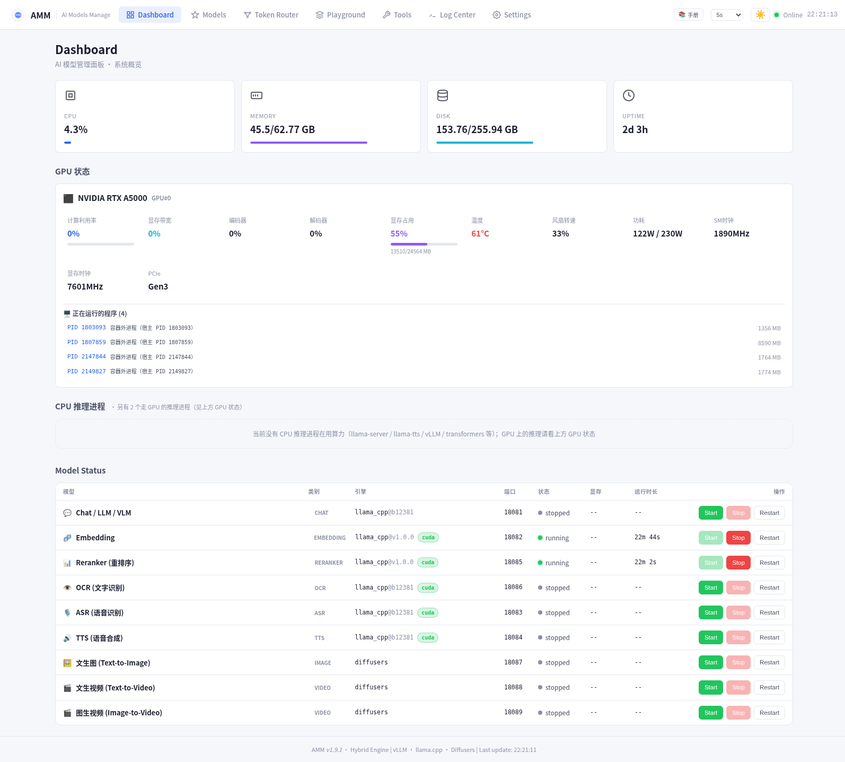
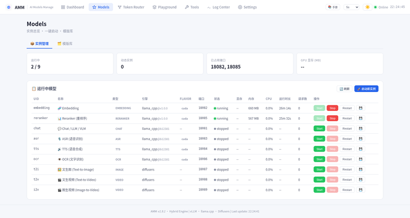
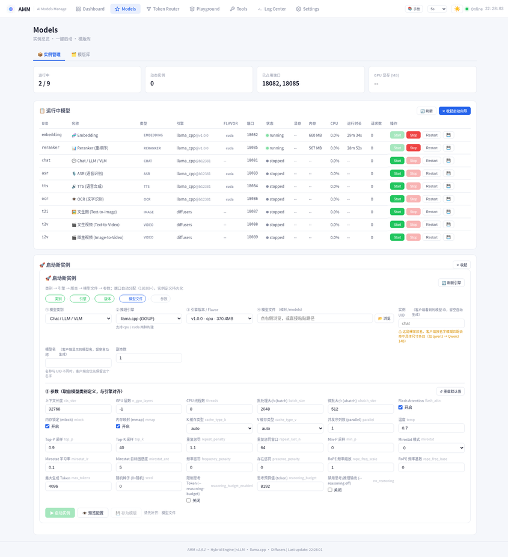
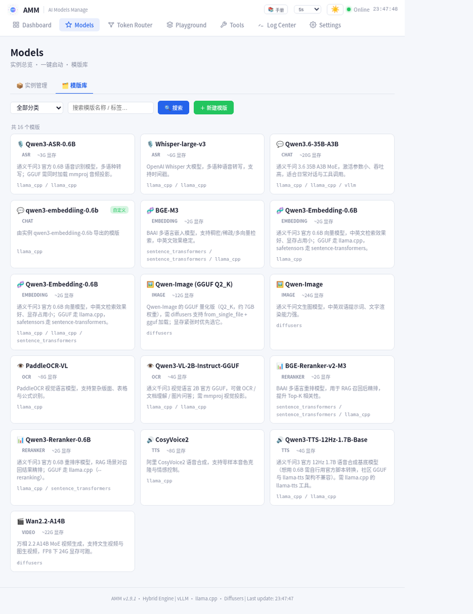
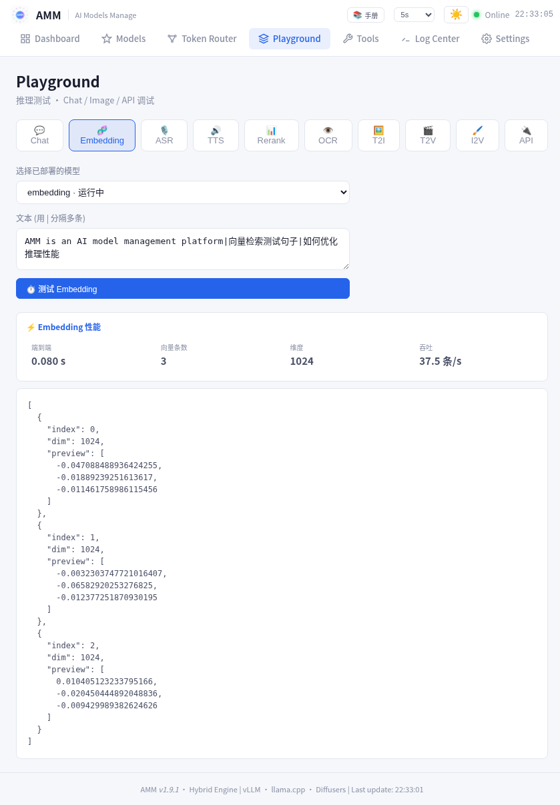
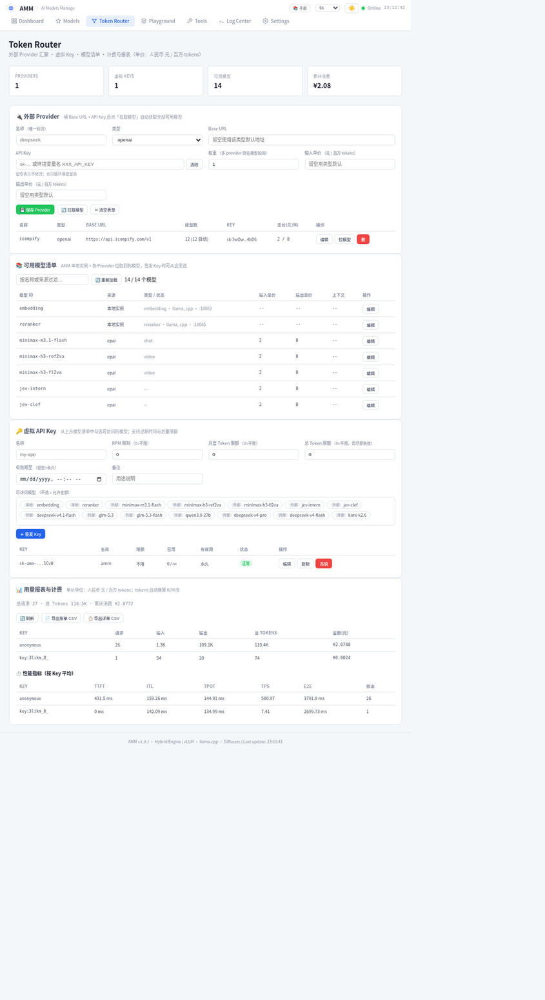
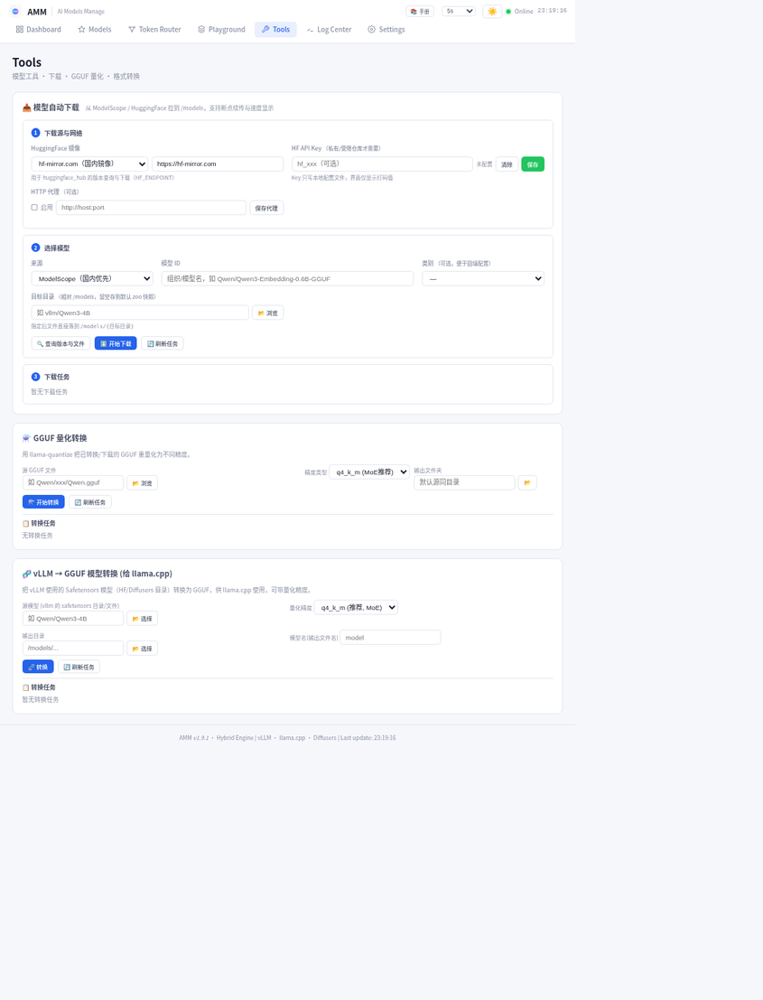
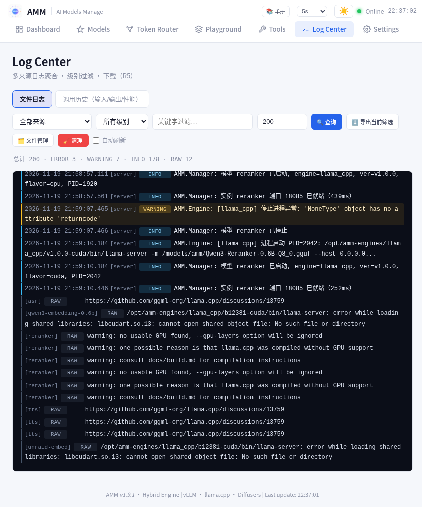

# AMM — AI Models Manage

**九类本地 AI 模型 × 四种推理引擎，收进一个网页管理界面。**

[](https://github.com/ggerganov/llama.cpp)
[](https://python.org)
[](LICENSE)
[](CHANGELOG.md)
[](#快速开始)

**简体中文** ｜ [English](./README.en.md)

---

## 一分钟了解

AMM 是一个自托管的 AI 模型管理平台。它把 **九类模型**——对话（Chat/LLM/VLM）、向量（Embedding）、
重排（Reranker）、语音识别（ASR）、语音合成（TTS）、OCR、文生图（T2I）、文生视频（T2V）、
图生视频（I2V）——和 **四种推理引擎**——llama.cpp / vLLM / Diffusers / sentence-transformers——
统一到 **一个网页界面** 里：

> 选模型 → 点启动 → 页面内测试 → 把 OpenAI 兼容的 `base_url` 填进任意客户端。

不用记几十个启动参数，不用给每类模型写一套脚本，不用自己再搭一层 API 网关。

```
浏览器 ──► AMM WebUI (:80)
              │
              ├── /api/*   管理接口（实例 / 引擎 / 文件 / 日志 / 监控）
              └── /v1/*    OpenAI 兼容 API（chat / embedding / asr / tts / ocr / rerank / images / videos）
                     │
        ┌────────────┼─────────────┬──────────────────┐
     llama.cpp       vLLM       Diffusers      sentence-transformers
     (GGUF/CPU+GPU) (高吞吐)   (图像/视频)        (Embedding)
```

### 适合谁

| 你是 | AMM 帮你 |
|---|---|
| **本地 AI 爱好者** | 不用折腾 Python / CUDA / 编译，装好就能跑各类模型 |
| **自托管 / 家庭实验室用户** | 一台 GPU 机器跑多个模型，统一入口、统一监控 |
| **开发者** | 同时管 llama.cpp 与 vLLM 等多套引擎，参数、版本、日志都在一个界面 |
| **小团队 / 内网服务方** | 用 Token Router 对外提供 MaaS：虚拟 Key、限流、配额、用量与计费 |
| **RAG / Agent 应用开发者** | embedding + reranker + chat 一条链本地闭环，一个 base_url 全搞定 |

### 它替你省掉什么

| 传统做法 | 用 AMM |
|---|---|
| 查文档、拼几十个启动参数 | 界面选引擎、选模型文件，参数自动带出 |
| 每类模型各写一套启动脚本 | 九类模型统一实例模型：start / stop / restart |
| 自己搭 API 网关做鉴权和计费 | 内建 OpenAI 兼容 API + Token Router |
| 换引擎要重装环境 | 网页里装卸引擎版本，CPU / CUDA 构建分开管理 |
| 出问题只能翻屏滚日志 | 日志中心按来源/级别过滤，一键下载 |

---

## 界面预览

















> 更多截图见 [docs/screenshots/](./docs/screenshots/)。

---

## 核心能力

### 九类模型，一个实例模型

| 类别 | 用途 | 引擎 |
|---|---|---|
| Chat / LLM / VLM | 对话、文本生成、看图说话 | llama.cpp、vLLM |
| Embedding | 向量化、语义检索、RAG | llama.cpp、sentence-transformers |
| Reranker | 检索结果精排 | llama.cpp |
| ASR | 语音转文字 | llama.cpp |
| TTS | 文字转语音 | llama.cpp |
| OCR | 图片文字识别 | llama.cpp |
| T2I | 文生图 | Diffusers |
| T2V | 文生视频 | Diffusers |
| I2V | 图生视频 | Diffusers |

### 四种推理引擎，可在线装卸

| 引擎 | 适用 | 构建 |
|---|---|---|
| llama.cpp | chat / embedding / reranker / asr / tts / ocr | cpu、cuda |
| vLLM | chat / embedding（高吞吐） | cuda |
| Diffusers | 图像 / 视频生成 | cuda |
| sentence-transformers | embedding | cpu、cuda |

版本可在线查询、下载、安装、卸载；同一类别可并行跑多个实例（不同模型 / 精度），各有独立 UID 与端口。

### OpenAI 兼容，任何客户端都能接

```
/v1/chat/completions      /v1/embeddings
/v1/audio/transcriptions  /v1/audio/speech
/v1/ocr                   /v1/rerank
/v1/images/generations    /v1/videos/generations
/v1/models                /v1/models/{id}
```

Cherry Studio、Open WebUI、Chatbox、OpenClaw、Claude Code 或任意 OpenAI SDK，只改 `base_url` 即可。

### Token Router：对外服务的网关

- 接入外部 provider（OpenAI / Anthropic / DeepSeek / 积算 / 自定义），填 Base URL + Key 自动拉取模型
- 签发虚拟 API Key：RPM 限流、月度/总量配额、有效期、模型白名单
- 用量与计费报表（按 Key / 模型），可导出 CSV
- 调用历史记录每次推理的输入、真实输出与性能指标（TTFT / TPS）

### 运维不靠记命令

| 能力 | 说明 |
|---|---|
| 实时监控 | CPU / 内存 / 磁盘 / GPU（利用率、显存、温度、功耗、占用进程） |
| CPU 进程监控 | 单独列出 CPU 推理进程：PID / 程序 / CPU / 内存 / 线程 / 运行时长 |
| 日志中心 | 按来源/级别/关键字过滤，导出、清理，自动轮转，前端轮询已降噪 |
| 文件管理 | 网页内浏览 / 编辑 / 上传 / 下载，限定在允许目录，删除进回收站 |
| 模版库 | 开箱模版覆盖 ASR / TTS / Embedding / Reranker / VLM / OCR / 图像 / 视频，一键创建；也可把自己的实例存成模版 |
| 启动命令编排 | 按当前参数生成完整命令行 → 人工修改 → 存成启动脚本，start/stop 优先执行 |
| 设置搜索 | Settings 全文搜索 + 分区索引 + 一键全部展开 |
| 品牌定制 | 项目名、副标题、LOGO 可改，标题栏与 favicon 同步 |
| 浅色主题 | ☀️ / 🌙 一键切换，localStorage 记忆 |

---

## 快速开始

目标：**5 分钟内完成安装，并跑通第一次推理请求。**

### 0. 环境要求

- Linux（Rocky 9 / Ubuntu 22.04 / Debian 12，或 Unraid 7.x）
- Python 3.11+（镜像内已自带）
- NVIDIA GPU 可选：纯 CPU 能跑 embedding 与小语言模型；跑 7B 以上或视频建议 ≥24GB 显存
- 用 GPU 时需 CUDA 13.2+；镜像已自带完整工具链（含 nvcc），缺组件 `install.sh` 会自动补

### 1. 启动容器

```bash
# 准备目录
mkdir -p /path/to/amm/{app,data,logs,engines} /path/to/models

docker run -d --name AMM \
  --restart unless-stopped \
  --runtime nvidia \
  -e NVIDIA_VISIBLE_DEVICES=all \
  -e NVIDIA_DRIVER_CAPABILITIES=compute,utility \
  -e TZ=Asia/Shanghai \
  -e AMM_ROOT=/amm \
  -e PYTHONPATH=/amm/backend \
  -e MODELS_DIR=/models \
  -e AMM_ENGINES_ROOT=/opt/amm-engines \
  -p 60008:80 \
  -v /path/to/amm/app:/amm \
  -v /path/to/amm/data:/amm/data \
  -v /path/to/amm/logs:/amm/logs \
  -v /path/to/models:/models \
  -v /path/to/amm/engines:/opt/amm-engines \
  <your-image> /bin/bash -c "sleep infinity"
```

> 没有 GPU 就删掉 `--runtime nvidia` 与两条 `NVIDIA_*` 环境变量。
> 端口 `60008` 可改成任意空闲端口。

**Unraid 用户**：仓库自带 dockerMan 模板，容器带 `managed` / `webui` / `icon` 三个标签，
在 Docker 页可直接启停、编辑、重建：

```bash
bash deploy/sync-unraid-template.sh --recreate
```

### 2. 安装依赖

```bash
docker exec -it AMM bash
cd /amm && bash deploy/install.sh
```

### 3. 启动服务

```bash
docker restart AMM
```

### 4. 确认起来了

```bash
curl http://<服务器IP>:60008/api/health
# {"status": "ok", "timestamp": "..."}

curl http://<服务器IP>:60008/v1/models
# 列出当前已启动的模型
```

浏览器打开 `http://<服务器IP>:60008/`，应该看到 Dashboard 和 GPU / CPU 状态。

### 5. 跑第一个模型

1. **Models → 模版库**，挑一个模版（如 `qwen3-embedding-0.6b`），点「创建实例」
2. 确认模型文件路径（`/models` 下的 `.gguf` 或权重目录），点「启动」
3. 等状态变成 **running**，右侧会显示分配到的端口
4. 去 **Playground → Embedding**，输入一句话点测试，能看到维度和耗时即为成功

> 手上还没有模型？去 **Tools → 📥 模型自动下载**，填 HuggingFace / ModelScope 的仓库名，
> 支持断点续传与按文件选择，下载完直接出现在 `/models`。

### 卡住了看这里

| 现象 | 先查 |
|---|---|
| 引擎编译 / 安装失败 | [CUDA 与引擎安装避坑指南](./docs/CUDA与引擎安装避坑指南.md) |
| 模型起不来、端口占用 | [故障排查](./docs/manual/08-故障排查.md) |
| 容器 / 模板 / 图标问题 | [部署 Unraid 标准容器](./docs/部署-Unraid标准容器.md) |
| 参数不会调 | [引擎参数调优指南](./docs/引擎参数调优指南-20260807.md) |

---

## 实战示例

### 1. 给 Cherry Studio 提供 Embedding

```
AMM → Models 启动 embedding 实例（UID 留空自动生成，如 qwen3-embedding-0.6b）
→ Cherry Studio → 设置 → 添加 Provider → 类型选 OpenAI
→ API 地址：http://<服务器IP>:60008/v1
→ API Key：填 AMM 里配置的 key（未开启鉴权可留空）
→ 点「获取模型列表」，应能看到刚才启动的实例
```

> **UID 别用裸家族名**（如 `qwen3`）。某些客户端会按名字猜上下文长度，
> 把 embedding 实例误认成 `Qwen3 14B` 并隐藏 embedding 能力。界面会实时提示。

验证：在 Cherry Studio 里对该 provider 做一次「测试」，或直接

```bash
curl http://<服务器IP>:60008/v1/embeddings \
  -H 'Content-Type: application/json' \
  -d '{"model":"qwen3-embedding-0.6b","input":"hello"}'
```

### 2. 用 Token Router 统一转发多个厂商

```
Token Router → 添加 Provider（openai / anthropic / deepseek / 积算 / 自定义）
→ 填 Base URL + Key，点「拉取模型」自动同步可用列表
→ 签发虚拟 Key：设 RPM、月度配额、有效期、允许的模型
→ 把同一个 base_url 发给不同应用，按 Key 分别看用量与花费
```

适合把这些场景收口：多个业务方共用一个出口、按项目拆分账单、给外部试用限流。

### 3. 文生图 / 文生视频

```
Models → 类别选 image 或 video → 引擎 Diffusers → 选模型 → 启动
Playground → T2I / T2V / I2V 页签 → 填 prompt → 生成
```

显存紧张时在实例「高级配置」里开 CPU Offload 或调低量化档位，Diffusers 的 FP8 存储 + BF16 计算
可让 24GB 卡跑 Wan2.2-A14B MoE 这类视频模型。

### 4. 接进任何 OpenAI 客户端 / Agent

```
base_url: http://<服务器IP>:60008/v1
api_key:  <AMM 中设置或留空>
model:    <实例 UID>
```

`/v1/chat/completions` 支持流式与 tool calling；openai_bridge 会自动清洗未锚定 `^` 的
JSON-Schema `pattern`，兼容 OpenClaw 一类客户端，避免 `HTTP 400 Pattern must start with '^'`。

---

## 架构

```
┌──────────────────────────────────────────────┐
│              AMM Web UI (原生 JS)             │
│ Dashboard │ Models │ Playground │ Router │ Log │
└───────────────────────┬──────────────────────┘
                        │ REST / SSE
┌───────────────────────▼──────────────────────┐
│               AMM Backend (aiohttp)          │
│  ┌──────────┬───────────┬─────────────────┐  │
│  │ 引擎注册  │ 实例生命周期 │ 模型 / 文件管理  │  │
│  └────┬─────┴─────┬─────┴────────┬────────┘  │
│       │           │              │           │
│  ┌────▼────┐ ┌────▼────┐  ┌──────▼───────┐   │
│  │llama.cpp│ │  vLLM   │  │  Diffusers   │   │
│  │ (GGUF)  │ │ (高吞吐) │  │ (图/视频)     │   │
│  └─────────┘ └─────────┘  └──────────────┘   │
│         ┌──────────────────────┐             │
│         │ sentence-transformers│             │
│         └──────────────────────┘             │
└──────────────────────────────────────────────┘
```

## 目录结构

```
amm/
├── backend/
│   ├── api/          HTTP 接口（OpenAI 桥接、路由、文件管理）
│   ├── core/         实例管理、引擎注册、SSE 捕获、客户端兼容
│   ├── engines/      引擎实现（llama_cpp / vllm / diffusers / st / quantizer）
│   ├── config/       models_config.yaml
│   ├── tests/        回归测试
│   └── server.py     服务入口
├── frontend/         原生 JS 单页应用（无构建步骤）
├── templates/        模型模版（YAML，按类别分目录）
├── deploy/           install.sh / Dockerfile / Unraid 模板 / CUDA 组件包
├── scripts/          开发与测试辅助脚本
└── docs/             手册 / 运维 / 部署 / 维护记录 / 截图
```

## API 速查

| 分组 | 代表接口 |
|---|---|
| 系统 | `GET /api/health`、`/api/system`、`/api/gpu`、`/api/engines` |
| 实例 | `GET /api/instances`、`POST /api/instances/{id}/start|stop|restart` |
| 参数 | `PUT /api/instances/{id}/parameters`、`GET|PUT /api/instances/{id}/advanced` |
| 启动命令 | `GET|PUT|DELETE /api/instances/{id}/command`、`POST .../command/preview` |
| 文件 / 预设 | `GET /api/fs/list`、`GET /api/fs/discover`、`GET|POST /api/instances/preset` |
| 运维 | `POST /api/settings/reload`、`POST /api/settings/restart` |
| OpenAI | `/v1/models`、`/v1/chat/completions`、`/v1/embeddings`、`/v1/audio/*`、`/v1/ocr`、`/v1/rerank`、`/v1/images/generations`、`/v1/videos/generations` |

完整清单见 [Web API 使用指南](./docs/manual/03-API使用指南-零IT版.md) 与 [Agent 版](./docs/manual/04-API使用指南-Agent版.md)。

## 文档

**日常运维从这里开始** → [运维操作手册](./docs/运维操作手册.md)（命令可直接复制）

| 文档 | 用途 |
|---|---|
| [用户手册](./docs/manual/) | 产品介绍 / WebUI 教程 / API 指南 / 架构 / 安装 / 排错 / 维护 / FAQ |
| [运维操作手册](./docs/运维操作手册.md) | 启停 / 升级 / 重建镜像 / 引擎管理 / 排障 / 备份恢复 |
| [部署 Unraid 标准容器](./docs/部署-Unraid标准容器.md) | dockerMan 模板、端口、图标、验收 |
| [CUDA 与引擎安装避坑指南](./docs/CUDA与引擎安装避坑指南.md) | 编译 CUDA 引擎的六类坑 |
| [引擎参数调优指南](./docs/引擎参数调优指南-20260807.md) | llama.cpp / vLLM 参数取值 |
| [开发经验沉淀](./docs/开发经验沉淀-v1.9.md) | 架构取舍与踩坑记录 |
| [CHANGELOG](./CHANGELOG.md) | 版本演进（v0.1 → v1.9.4） |

## 技术栈

| 层 | 技术 |
|---|---|
| 后端 | Python 3.11 + aiohttp（异步，无 ORM） |
| 前端 | 原生 JavaScript，单页应用，零构建 |
| 存储 | SQLite（实例定义）+ JSON（路由 / 配置） |
| 推理 | llama.cpp / vLLM / Diffusers / sentence-transformers |
| 部署 | Docker / Unraid dockerMan / 裸机 |

设计取向：**零构建、零前端框架、单进程**，改代码只需重启容器。

---

## 项目信息

- **负责人（撞强）**：xt@pcd.name ｜ 微信：13808230006
- **MaaS 服务供应商**：北京积算（icompify）— <https://www.icompify.com/>
- **当前版本**：v1.9.4 ｜ **测试用 Runtime**：Unraid dockerMan 标准容器

## 反馈与试用招募

AMM 目前处于**测试阶段**，正在寻找第一批真实使用者。任何反馈都有价值——不只是 bug，
「装不上」「文档这段看不懂」「我想要的场景这里没有」同样重要。

**怎么反馈**

| 你想说 | 去哪 |
|---|---|
| 报 bug / 提需求 | [GitHub Issues](https://github.com/xztjhs/amm/issues) |
| 分享使用体验、贴配置 | Issues 里开一条「使用体验」 |
| 直接聊 | 微信 13808230006 ｜ 邮箱 xt@pcd.name |

**报 bug 时请带上这几项**，能省掉一轮来回：

```text
版本：AMM v1.9.4（界面右下角 / GET /api/health）
Runtime：Docker / Unraid dockerMan / 裸机，GPU 型号与显存
复现步骤：点了什么 → 期望什么 → 实际什么
日志：Settings → 下载日志，或容器内 logs/ 目录
```

试用期我们优先响应：**装不上、起不来、结果不对** 这三类问题。

## 贡献

欢迎 Issue 与 PR。提交前请：

1. 跑通 `pytest`（后端回归）
2. 保证 `deploy/install.sh` 在纯净环境可执行
3. 新增功能同步更新 `docs/manual/`

## License

[MIT](./LICENSE)

## 致谢

- [llama.cpp](https://github.com/ggerganov/llama.cpp) — GGUF 推理
- [vLLM](https://github.com/vllm-project/vllm) — 高吞吐推理
- [Diffusers](https://github.com/huggingface/diffusers) — 图像 / 视频生成
- [aiohttp](https://github.com/aio-libs/aiohttp) — 异步 HTTP
